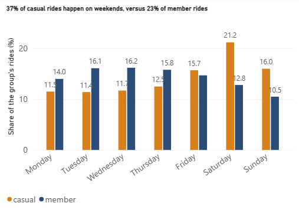
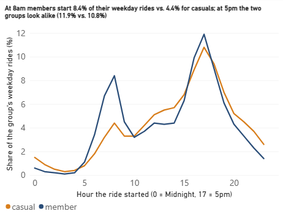
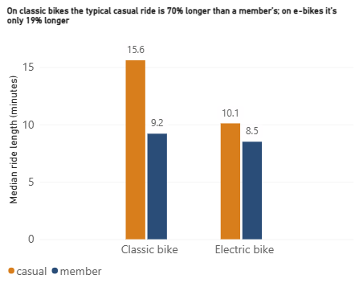
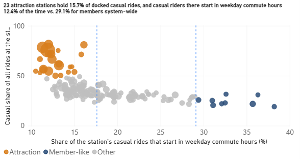

# Cyclistic Bike-Share: How Do Casual Riders and Annual Members Ride Differently?

Capstone case study for the Google Data Analytics Certificate. Python/pandas analysis of 12 months of Divvy trip data (Oct 2025 to Sep 2026), standing in for the fictional company Cyclistic. Cleaning and analysis are in Python, the dashboard is in Power BI, and the findings are presented in a short deck.

## Deliverables

| What | Where |
|---|---|
| Presentation for the marketing director and executive team | [`deck/cyclistic_deck.pdf`](deck/cyclistic_deck.pdf) |
| Power BI dashboard (4 visuals) | [`dashboard/cyclistic.pbix`](dashboard/cyclistic.pbix), screenshots in [`dashboard/screenshots/`](dashboard/screenshots/) |
| Cleaning audit (row counts for every removal) | [`reports/cleaning_audit.csv`](reports/cleaning_audit.csv) |
| Analysis notebooks | [`notebooks/`](notebooks/) |

## Summary

- **Casual riders ride longer, but mostly on classic bikes.** On classic bikes the typical casual ride is 70% longer than a member's (15.6 vs. 9.2 min). On e-bikes the gap is 19% (10.1 vs. 8.5 min).
- **Casuals lean toward weekends and summer.** 37% of casual rides happen on weekends vs. 23% of member rides, and 46% of casual rides happen in summer vs. 37% for members. Even so, about 1.3M casual rides are on weekdays, against about 785K on weekends.
- **Timing is where the groups overlap.** At the 5pm weekday rush the two groups look alike (11.9% vs. 10.8% of their rides). The 8am rush is mostly a member pattern (8.4% vs. 4.4%).
- **Casual volume is concentrated at attractions.** 23 stations such as Navy Pier and Shedd Aquarium hold 15.7% of docked casual rides, but only 12.4% of those rides start in weekday commute hours.
- **Recommendation:** run two controlled tests with promo-code tracking, not a rollout, so that conversions can finally be measured.

## 1. Business task

Determine how casual riders and annual members differ in when, where, how long, and on which bike type they ride, so that Lily Moreno's marketing team can decide where, when, and how to run membership promotions. Findings will be presented to the executive team for approval.

**Out of scope:** The case study assigns this analysis to the first of its three questions (how members and casual riders use the bikes differently). The other two (why casual riders would buy a membership, and how digital media could influence them) need survey and marketing data this dataset doesn’t have.

## 2. Data sources

- **Source:** Divvy monthly trip files from [Divvy's system data page](https://divvybikes.com/system-data), downloaded from the [public trip-data bucket](https://divvy-tripdata.s3.amazonaws.com/index.html). Twelve files, Oct 2025 through Sep 2026, 6,171,785 rows in total. Divvy is Chicago's real bike-share system, used here in place of the fictional Cyclistic. The data is provided under the [Divvy Data License Agreement](https://www.divvybikes.com/data-license-agreement). Raw files are not redistributed in this repo, because the license does not allow publishing the data as a standalone dataset. This project is not affiliated with or endorsed by Divvy.
- **Schema (13 columns):** `ride_id`, `rideable_type` (classic or electric bike), `started_at`, `ended_at`, start and end station name and ID, start and end latitude and longitude, `member_casual`. One row is one ride, not one rider.
- **ROCCC assessment**
  - *Reliable:* first-party operator data, but see the integrity issues in section 3.
  - *Original:* straight from the system's operator.
  - *Comprehensive:* weak in important ways. No rider IDs, pricing, demographics, or trip purpose. About 21% of rides have no start station (almost all e-bikes, which can be locked outside docks).
  - *Current:* the most recent 12 complete months at the time of analysis.
  - *Cited:* the source and license are linked above, and the files are reproducible from the public page.
- **Privacy:** the data contains no personally identifiable information, so this analysis describes rides, not riders.

## 3. Cleaning and data integrity

Tools: Python, pandas, Jupyter. Raw files were never edited. Every cleaning step is logged with row counts (`reports/cleaning_audit.csv`).

| Step | Rows removed | Rows remaining |
|---|---|---|
| Loaded 12 files (reconciled to source line counts) | | 6,171,785 |
| Exact duplicate rides (appear in two adjacent files) | 35 | 6,171,750 |
| Started before Oct 1 2025 | 71 | 6,171,679 |
| Negative duration | 29 | 6,171,650 |
| Over 24 hours | 5,304 | 6,166,346 |
| Under 60 seconds | 159,192 | 6,007,154 |

Total removed: 164,631 rows (2.7%). **Final analysis set: 6,007,154 rides** (3,896,850 member, 2,110,304 casual).

**Rules and reasoning**

- **Negative duration:** all 29 are on Nov 2, 2025 in the 1am hour, when the clocks went back. The timestamps carry no time zone, so I cannot tell which pass through the repeated hour each belongs to. Adding an hour back gives believable ride lengths (5 to 48 minutes), but that is a guess, so the rides were removed instead of repaired. Rides near a daylight-saving change may be off by an hour in ways that do not show up as negatives.
- **Over 24 hours:** durations pile up between 24.5 and 25 hours (5,227 of the 5,324 rides in the cluster) and nothing runs past 26, a pattern consistent with system-closed records, not real trips. 5,143 of the 5,324 have no end location. All are classic bikes and about 79% are casual.
- **Under 60 seconds:** all 159,192 are e-bikes (classic bikes have none). Among the 48,450 with both stations known, 92.9% start and end at the same station, consistent with false starts and re-docks. One hypothesis, not verified against Divvy's documentation, is that the source filters short trips at docks but cannot do so for dockless e-bike rides.
- **Robustness check:** keeping the sub-minute rides narrows the median ride-length gap from 2.5 to 2.2 minutes and leaves weekend and summer shares essentially unchanged. The findings do not depend on this decision.

**Integrity issues found in the source data**

1. **Mislabeled file.** The January 2026 zip (`202601`) contains a file named `202501-divvy-tripdata.csv`. Its dates run from 2025-12-31 to 2026-01-31, so it was renamed to `202601`.
2. **Files are partitioned by ride end date, not start date.** 734 rides started before their file's labeled month, and 100% of them ended inside it. The analysis window is therefore defined by `started_at`, not by filename.
3. **Boundary-crossing rides can appear in two files.** All 35 duplicates are exact copies in the April and May files, for rides that began on Apr 30 and ended on May 1. I did not find why this happens only at this one boundary.
4. **Missing stations are an e-bike issue.** 0% of classic-bike rides lack a start station vs. about 29% of e-bike rides. The null rate is similar for casual and member riders (21.8% vs. 20.4%), so it does not bias the group comparison, but every station analysis covers only docked rides (about 80% of rides) and says so.

One edge effect: rides that started on Sep 30 2026 and ended in October sit in a file that was not downloaded. The loss is negligible.

## 4. Analysis and findings

Comparisons use each group's *share of its own rides*, because members account for about 65% of all rides and raw counts would bury the pattern differences. Ride length is reported as a median, because it is heavily right-skewed (casual mean 18.2 min vs. median 11.1).

### Finding 1: 37% of casual rides happen on weekends, versus 23% of member rides



Saturday is the biggest casual day (21.2%). This is a share, not a headcount: in absolute terms members still take more weekend rides (906K vs. 785K), and casuals take 1.33M weekday rides. Weekends are where casuals stand out, not where most of them are. Casual riding is also far more seasonal: 46% of casual rides are in summer and 4% in winter, versus 37% and 10% for members.

### Finding 2: At 8am members start 8.4% of weekday rides vs. 4.4% for casuals; by 5pm the groups look alike



Casuals have a small morning bump, not a flat line. On weekends the two curves nearly overlap. Rides in commute hours *resemble* member behavior, but without rider IDs we cannot say who is commuting. Top starting stations at 5pm differ: casual rides start mostly at lakefront attractions, member rides downtown. This suggests leisure for casuals, but it is an inference.

### Finding 3: On classic bikes the typical casual ride is 70% longer than a member's; on e-bikes it's only 19% longer



Median casual classic-bike ride: 15.6 min vs. 9.2 for members. On e-bikes: 10.1 vs. 8.5. Classic bikes are 26% of casual rides and 32% of member rides. The data cannot say why.

### Finding 4: 23 attraction stations hold 15.7% of docked casual rides, but only 12.4% of those rides start in weekday commute hours



Navy Pier alone has 49,557 casual starts. The casual average is 17.6% and the member average 29.1% (system-wide). A few stations (for example Clinton & Washington, Canal & Madison, Wells & Randolph) show casuals riding in commute hours at or above the member rate, but casuals are only 19 to 32% of riders there.

| Group | Stations | Casual rides | Share of docked casual rides |
|---|---|---|---|
| Attraction (below casual-average commute share, 50%+ casual) | 23 | 263,416 | 15.7% |
| Member-like (commute share at or above member average) | 9 | 40,090 | 2.4% |

Both group definitions use my own cutoffs, applied to stations with 3,000+ casual rides. They are not natural breakpoints. Weekday commute-window casual rides total 295,136 (17.6% of docked casual rides) and are spread across the system, not concentrated in a few stations.

## 5. Recommendations

1. **Test:** promote memberships at the 23 attraction stations on summer weekend afternoons. They hold the most casual riders in the fewest locations.
2. **Test:** promote at the 9 member-like stations during weekday commute hours (7 to 9am, 4 to 6pm). Only 2.4% of docked casual rides start there, but those riders already behave like members, so their conversion rate may be much higher. Running both tests shows whether reach or fit matters more.
3. **Measure:** count sign-ups per 1,000 riders reached, versus control stations running at the same time with no promotion, using a promo code for each test station. This dataset cannot measure conversion, so the test has to create the data. Compare against control stations, not last month or last year, because casual riding swings about 11x between summer and winter.

**Why test, not roll out.** We should test at attraction stations because they hold the most casual riders (15.7% of docked casual rides in 23 stations), and we can't assume it works because those riders look like visitors, the group least likely to need an annual pass, and this data can't tell visitors from locals.

## 6. Limitations

- **Rides, not riders.** There are no rider IDs, so one person could account for many rides, and visitors cannot be separated from locals.
- **Descriptive, not causal.** The analysis shows how the groups differ, not why, and not what would make a casual rider convert.
- **Analyst-chosen cutoffs.** The commute hours (weekday 7 to 9am and 4 to 6pm), the 50% casual-share line, and the 3,000-ride station floor are my choices.
- **Station analysis covers about 80% of rides** (docked starts only).
- **Timestamps have no time zone,** so rides near daylight-saving changes may be off by an hour.
- **One year of data.** Seasonal patterns cannot be checked against other years.

## 7. Data that would strengthen this

- Pass-purchase records linked to an anonymous rider ID, to see who actually converts and how long it takes.
- Sign-ups from the two promotion tests in recommendations 1 and 2.
- Rider survey data on trip purpose and why casuals do or do not buy (case study question 2).
- Marketing channel data for case study question 3.

## 8. Reproducing this analysis

```
data/raw/        12 monthly CSVs (not in the repo; download from Divvy's system-data page)
notebooks/       01_load_inspect, 02_clean_audit, 03_features, 04_analysis, 05_charts, 06_dashboard_export
dashboard/       cyclistic.pbix, screenshots/, data/ (five small aggregate CSVs the dashboard reads; no ride-level data)
deck/            cyclistic_deck.pdf
reports/         load_log.csv, cleaning_audit.csv
```

Python 3 with pandas, numpy, matplotlib, pyarrow. Run the notebooks in order, each from inside the `notebooks/` folder (the file paths are relative). Cleaned data is saved as Parquet between steps: notebook 03 builds `rides_features.parquet`, which notebooks 04 to 06 read, and notebook 06 regenerates the five summary CSVs in `dashboard/data/`. The Power BI file reads those CSVs by path, so if it cannot find them, point it at `dashboard/data/` (Transform data, then Data source settings).
